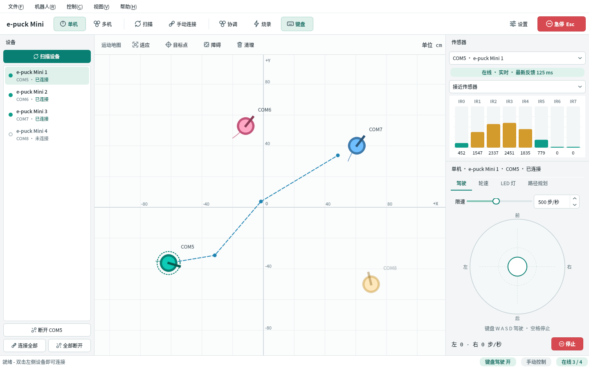
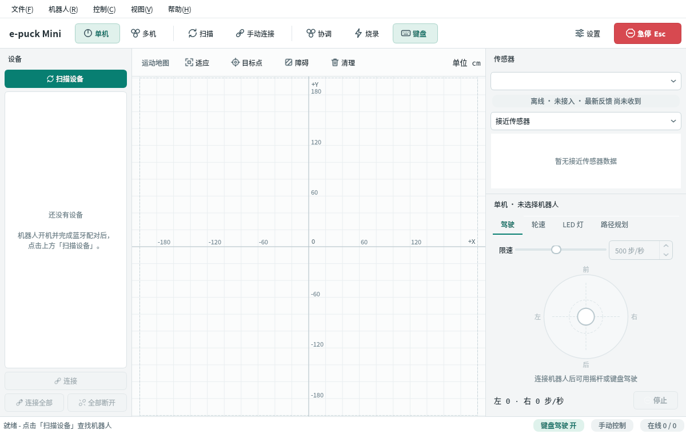
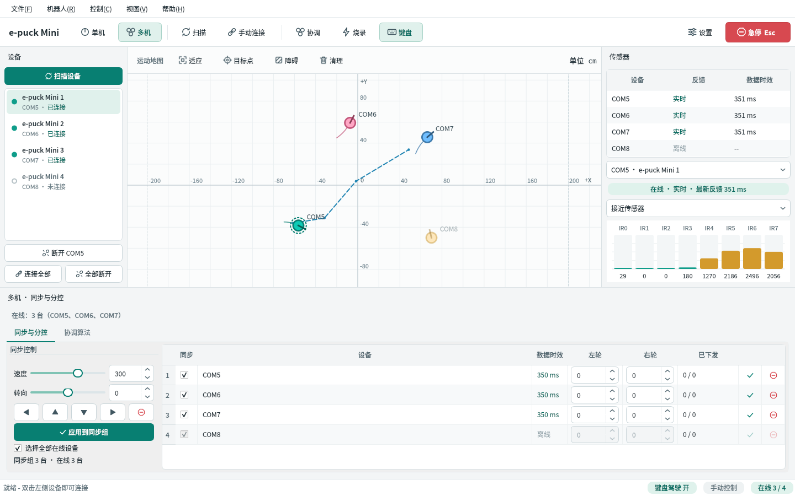
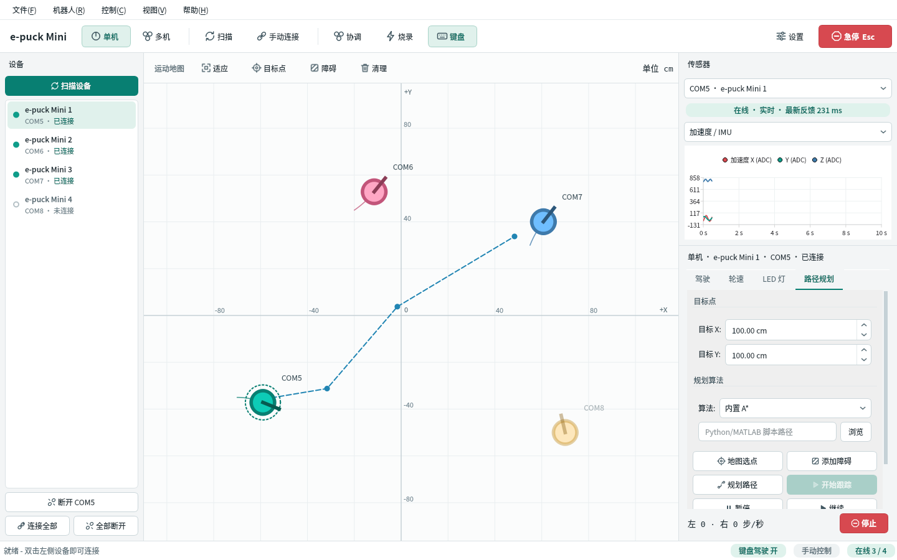

# e-puck Mini 多机器人控制中心

**版本 0.6.0 · Windows x64（免安装）· 蓝牙 SPP / COM 串口**

在电脑上连接、驾驶和观察 e-puck Mini 机器人的桌面软件。一台或多台都可以：单机模式用摇杆或键盘驾驶、看传感器、做路径规划；多机模式让一组机器人同步运动，同时还能逐台单独控制。

**[⬇ 下载 Windows 软件包](https://github.com/1405264556/epuck_mini_control/releases/latest)** · [版本修改记录](CHANGELOG.md)



> 文中截图里的机器人和传感器数据都是模拟数据。

## 目录

- [3 分钟上手](#3-分钟上手)
- [界面一览](#界面一览)
- [驾驶一台机器人](#驾驶一台机器人)
- [同时控制多台](#同时控制多台)
- [地图与路径规划](#地图与路径规划)
- [查看传感器](#查看传感器)
- [掉线了会怎样](#掉线了会怎样)
- [设置](#设置)
- [常见问题](#常见问题)
- [安全须知与已知限制](#安全须知与已知限制)
- [开发者参考](#开发者参考)

## 3 分钟上手

| 步骤 | 操作 | 应该看到 |
| --- | --- | --- |
| 1 | 从 [Releases](https://github.com/1405264556/epuck_mini_control/releases/latest) 下载 ZIP，**完整解压**整个 `epuck_mini_control` 文件夹（不要只拖出 EXE） | 文件夹里有 `epuck_mini_control.exe` 和一堆 DLL |
| 2 | 机器人开机，在 Windows“蓝牙和其他设备”里完成配对 | 设备管理器的“端口”下出现对应的 COM 口 |
| 3 | 关掉官方 Monitor、串口助手等会占用该端口的程序 | — |
| 4 | 双击 **启动 e-puck Mini.cmd** 或 `epuck_mini_control.exe` | 主窗口打开，左侧提示“还没有设备” |
| 5 | 点左上角 **扫描设备** | 进度条走完后，识别到的机器人出现在列表里 |
| 6 | **双击**列表里的设备（多台就点“连接全部”） | 圆点变绿，显示“已连接”，右侧传感器开始跳动 |
| 7 | 拖动右下角的摇杆，或直接按 **W A S D** | 机器人运动，面板底部显示左右轮速 |
| 8 | 松手即停；**空格**停止，**Esc** 急停 | 轮速读数回到 0 |

不需要安装 Qt 或任何运行库。连接过的设备会被记住，下次启动直接在列表里，双击即可连接。

第一次使用建议把机器人架起来（轮子离地）或放在空旷处，并把“限速”调低一些。



## 界面一览

| 位置 | 内容 |
| --- | --- |
| 顶部工具栏 | **单机 / 多机**切换 · 扫描 · 手动连接 · 协调 · 烧录 · 键盘驾驶开关 · 设置 · 右侧红色 **急停** |
| 左侧“设备” | 每台机器人的名称、端口、连接状态。双击连接或断开，右键可移除设备、手动输入端口 |
| 中间“运动地图” | 机器人位置、走过的轨迹、规划路径、虚拟障碍。单位 cm |
| 右上“传感器” | 选中机器人的接近、加速度、麦克风、摄像头和原始数据 |
| 右下 / 底部控制区 | 单机：驾驶、轮速、LED、路径规划四个标签页；多机：同步与分控表、协调算法 |
| 底部状态栏 | 操作提示，以及键盘驾驶状态、控制方式、在线数量 |

状态颜色：**绿色**＝已连接 / 数据实时，**黄色**＝连接中、重连中或数据过期，**红色**＝连接失败，**灰色**＝未连接。

切换单机 / 多机不会断开任何连接。软件会记住窗口大小、上次的模式和限速。布局乱了可以用“视图 / 重置布局”恢复。

## 驾驶一台机器人

先在左侧列表或地图上点选要驾驶的机器人，然后在右下角“驾驶”页操作：

- **摇杆**：按住往哪边拖，机器人就往哪边走；拖得越远越快；松开立即停止。
- **键盘**：

  | 按键 | 作用 |
  | --- | --- |
  | W / S | 前进 / 后退 |
  | A / D | 左转 / 右转（和 W、S 一起按可以走弧线） |
  | 空格 | 停止 |
  | Esc | 急停：停止所有机器人，并结束正在运行的算法 |

- **限速**：摇杆上方的滑块，决定摇杆和键盘能给到的最大轮速（100～1000 步/秒，默认 500）。
- **轮速页**：分别设定左右轮的速度（-1000～1000 步/秒）。和摇杆不同，这里设的速度会**一直保持**，直到点“停止”。
- **停止按钮和轮速读数**固定在面板底部，切到哪个标签页都在。

键盘驾驶在这些情况下才生效：主窗口在最前面；光标不在输入框或下拉框里；面板停在“驾驶”页；工具栏的“键盘”按钮是按下状态（Ctrl+K 开关）。
松开按键、切换页面、切到其他窗口，机器人都会立即停止。

**LED 页**：点亮或关闭环形灯 0～7、机身灯、前灯。显示的是软件发出的指令，不是从机器人读回的状态。

其他快捷键：Ctrl+R 扫描 · Ctrl+Shift+C 手动连接 · Ctrl+L 日志面板。

## 同时控制多台



1. 连接好多台设备，点工具栏 **多机**。
2. 底部表格的“同步”列勾选哪些机器人编入同步组。
3. **同步驾驶**：左下设定“速度”和“转向”，然后
   - 按住方向按钮（或键盘 W A S D）：按住运动，松开停止；
   - 点“应用到同步组”：持续保持这个速度，直到点停止。
4. **单独控制**：在某一行直接填左右轮速度，点该行的 ✓ 应用、⊖ 停止，其他机器人不受影响。
5. **协调算法**页：对同步组运行队形保持或群集目标跟随，至少需要两台设备且有编码器反馈。

需要了解的行为：

- 取消勾选一台正在运动的机器人，会让它停下。
- 手动给轮速会结束正在运行的协调算法；有设备掉线，算法立即停止；编码器超过 1 秒没更新，算法暂停。
- “已下发”一列是软件发出的指令值，不代表机器人已经执行。
- 同步组的指令在电脑端按同一时刻发出，但蓝牙和固件各有延迟，**不是硬件级的精确同步**。

## 地图与路径规划

地图操作：**滚轮**缩放 · **拖动空白处**平移 · **双击空白处**适应全部 · 工具栏右侧显示鼠标所在坐标。+X 向右，+Y 向上。

- 点击机器人是选中它；**按住拖动**才会改变它在地图上的位置。这是用来告诉软件“机器人实际摆在哪”，机器人本身不会动。
- 地图位置由轮子编码器推算，没有外部定位，跑久了会漂移。开始前请把地图上的位置拖到和实际摆放一致。

路径规划（单机模式“路径规划”页）：

1. 点 **地图选点**，在地图上点目标位置（或直接输入 X、Y），软件自动规划。
2. 需要绕开某些区域时，点 **添加障碍**，在地图上连续点击放置。
3. 点 **开始跟踪**，机器人沿虚线行驶；可以暂停、继续，或点 **回原点** 回到 (0, 0)。
4. 面板底部的“停止”随时结束跟踪。

算法可选内置 A*，或自己的 Python / MATLAB 脚本（接口见[开发者参考](#算法与烧录扩展)）。虚拟障碍只存在于地图上，软件不会根据传感器自动避开真实障碍物。



## 查看传感器

右上角先选机器人，再选要看的内容：

| 选项 | 显示什么 | 说明 |
| --- | --- | --- |
| 接近传感器 | 8 路红外的柱状图 | 数值是原始响应强度，越近越大，**不是厘米距离** |
| 加速度 / IMU | X / Y / Z 曲线，最近 10 秒 | 原始 ADC 值，未换算成 m/s² |
| 麦克风 | 三路音量 | 是音量幅度，不是录音 |
| 摄像头 | 40×40 灰度图 | 只在停留此页时采集，会占用该机器人的通信带宽 |
| 数据与时效 | 所有信号的数值和状态表 | 每个信号独立标注 实时 / 过期 / 未接入 |
| ToF 测距 | — | 预留，当前固件协议下不采集 |

下拉框下方的色条显示“在线 · 实时 · 最新反馈 xx ms”。显示“过期”说明超过 1 秒没收到新数据。数值为 0 也是有效数据，和“未接入”不同。

## 掉线了会怎样

| 情况 | 软件怎么处理 |
| --- | --- |
| 蓝牙断开、机器人关机或走出范围 | 约 6 秒内发现，设备显示“重连中 1/3”，按 1、2、4 秒间隔自动重连 |
| 重连成功 | 状态栏提示“已自动重新连接”，传感器恢复 |
| 3 次都没连上 | 显示“连接失败”，机器人恢复后双击即可手动再连 |
| 重连等待中不想连了 | 双击该设备或点“断开” |
| 掉线时正在跑协调算法或路径跟踪 | 立即停止 |
| 软件停止发指令超过 1 秒（卡住等） | 自动给机器人发零速 |
| 关闭软件 | 先给所有机器人发停止指令再断开 |

第一次连接就失败（端口打不开、机器人没回应）不会自动重试，请看下面的常见问题。

## 设置

“文件 / 设置”或工具栏“设置”：

| 选项 | 默认 | 什么时候改 |
| --- | --- | --- |
| 连接意外中断后自动重连 | 开 | 想自己控制重连时关掉 |
| 最多重连 | 3 次 | 机器人重启较慢、总是重连失败时调大 |
| 启动时自动连接上次使用的设备 | 关 | 固定使用同一批机器人时打开 |
| 传感器轮询间隔 | 60 ms | 设备多或蓝牙不稳定、频繁超时时调大（如 100～200 ms） |
| 摇杆 / 键盘限速 | 500 步/秒 | 新手或场地小时调低 |
| 启用键盘驾驶 | 开 | 不想误触时关掉 |

## 常见问题

**扫描不到机器人**
确认机器人已开机、已在 Windows 里配对、设备管理器里有对应 COM 口，并且没有其他程序占用。每台配对的蓝牙设备通常有两个 COM 口，只有“传出”那个能用，另一个扫描时无响应是正常的。知道端口号的话，在设备列表右键选“手动输入端口”。

**连接失败，提示未收到握手反馈**
端口能打开但机器人没回应：多半是选了“传入”端口、机器人没开机，或固件不是 SerCom / BTcom 协议。

**连上了但传感器一直“未接入”，状态栏提示已降低轮询频率**
固件没有返回遥测数据。电机和 LED 仍然可以控制；需要传感器的话请确认固件版本。

**总是掉线、反复重连**
常见原因是机器人电量不足或距离太远。可以在设置里把轮询间隔调大、重连次数调大。

**按 W A S D 没反应**
依次检查：机器人已连接（绿点）→ 工具栏“键盘”按钮是按下状态 → 右下面板停在“驾驶”页 → 点一下地图空白处，让光标离开输入框。

**地图上的轨迹不动，或算法自己暂停了**
没有收到编码器数据。软件只根据编码器更新位置，不会按下发的速度“假装”移动。

**地图上的位置越来越不准**
编码器推算会累积误差。默认按轮径 4.1 cm、轮距 5.3 cm、每圈 1000 步计算，和实物有出入时偏差更大。可以随时把机器人拖回正确位置。

**摄像头页是空白**
需要固件支持图像命令，且只有停在摄像头页时才采集。

**想看详细日志**
Ctrl+L 打开日志面板；完整日志在 `%LOCALAPPDATA%\EPFL\e-puck Mini Control\epuck_mini_control.log`，反馈问题时请附上。

## 安全须知与已知限制

- 软件里的急停、失焦停止、指令超时停止都依赖电脑和蓝牙链路正常工作。**电脑死机或蓝牙彻底断开时，停止指令送不到机器人**。它们不能代替物理急停和场地隔离。
- 0.6.0 的掉线判定和自动重连是用模拟机器人测试的，**尚未在真实 e-puck Mini 上验证**；真实蓝牙端口恢复所需的时间可能比默认重连窗口长。
- 多机同步不是硬件时钟级同步；没有外部定位；虚拟障碍不是实时避障。
- ToF、陀螺仪、电池、红外遥控在当前协议下不采集。
- 多目标批量烧录、OTA、Python / MATLAB 协调算法的直接接入仍是预留接口。

---

## 开发者参考

以下内容面向需要改代码、写算法或排查通信问题的人。更细的说明见 [协调算法接口](docs/multi_robot_control.md) 和 [通信与验收说明](docs/communication_and_validation.md)。

### 源码构建与打包

依赖 Qt 6.5+（Core/Gui/Widgets/SerialPort/Bluetooth/Charts/Network/Concurrent/Test）、CMake 3.21+、Ninja。测试额外依赖 GoogleTest；Eigen 3.4 和 libusb 可选。

发布包由 GitHub Actions 构建（`.github/workflows/release.yml`）：推送到 main 会在 Linux 上跑测试、在 Windows 上编译打包并做启动自检；推送 `vX.Y.Z` 标签会再把 ZIP 发布到 Releases，发布说明取自 `docs/release-notes/vX.Y.Z.md`。

#### Windows（MinGW）

构建预设里的路径是作者本机的（Qt 在 F:/Qt/6.10.3/mingw_64，MinGW 在 F:/Tools/mingw64/mingw64），其他机器请改 `CMakePresets.json` 和打包参数。

```powershell
$env:PATH='F:\Tools\cmake-3.31.0-windows-x86_64\bin;F:\Qt\6.10.3\mingw_64\bin;F:\Tools\mingw64\mingw64\bin;' + $env:PATH
cmake --preset mingw-debug
cmake --build --preset mingw-debug --parallel 6
$env:QT_QPA_PLATFORM='offscreen'
.\build\mingw-debug\tests\epuck_tests.exe
Remove-Item Env:QT_QPA_PLATFORM
cmake --preset mingw-release
cmake --build --preset mingw-release --parallel 6
powershell -ExecutionPolicy Bypass -File .\tools\package.ps1
```

#### Linux

```bash
cmake -S . -B build -G Ninja -DCMAKE_BUILD_TYPE=Release -DCMAKE_PREFIX_PATH=/path/to/Qt/6.10.3/gcc_64
cmake --build build --parallel
QT_QPA_PLATFORM=offscreen ./build/tests/epuck_tests     # 约 1 分钟
./build/bin/epuck_mini_control
```

串口设备名直接用 `/dev/rfcomm0`、`/dev/ttyUSB0` 等，通过“手动连接”输入；当前用户需要有串口访问权限（通常是加入 `dialout` 组）。

#### 测试

- 协议、控制、调度和界面测试在所有平台运行。
- `tests/test_serial_link.cpp` 用伪终端模拟一台 e-puck（`tests/FakeEpuck.h`），让真实的串口线程与它完成握手、遥测、电机指令、掉线重连等完整流程。这部分只在 Linux / macOS 编译，Windows 上自动跳过。
- 重新生成文档截图：`EPUCK_UI_CAPTURE_DIR=docs/images QT_QPA_PLATFORM=offscreen ./build/tests/epuck_tests --gtest_filter='Screens.*'`

测试插件位置在配置时从 qmake 查询，无窗口 UI 测试显式加载 Windows 字体。软件包不包含测试用模拟设备。

### 连接监视细节

| 情况 | 软件行为 |
| --- | --- |
| 串口报错或设备被拔出 | 立即判定断开，进入自动重连 |
| 串口正常但设备不再应答（蓝牙假死） | 连续 8 次轮询无应答（约 5~6 秒）后判定断开，进入自动重连 |
| 自动重连 | 间隔 1、2、4、8 秒，默认最多 3 次；设备列表显示“重连中 n/3”，期间点“断开”即取消 |
| 重连次数用尽 | 状态变为“连接失败”，可手动再连 |
| 固件握手成功但从不返回遥测 | 保持连接，轮询降到每秒 1 次，电机和 LED 仍可控制 |
| 偶发遥测超时 | 自动重新同步，状态栏每段只提示一次 |
| 连接中断时正在运行协调算法或路径跟踪 | 立即停止 |
| 关闭程序 | 先给所有机器人发停止指令再断开，最多等待 2 秒 |

自动重连、重连次数、启动时自动连接、传感器轮询间隔都在“文件 / 设置”里调整。首次连接就失败（端口打不开、握手无应答）不会自动重试。

### 传感器协议

| 信号 | 当前 COM / BTcom 接入 | 含义 |
| --- | --- | --- |
| 8 路红外接近 | 连续轮询，负校准噪声归零，自适应平滑 | ADC 响应，不是 cm/mm 距离 |
| 加速度球坐标 | 连续轮询 | 固件幅度、方向、倾角 |
| 原始 XYZ 加速度 | 扩展连续轮询 | ADC，未标定不冒充 m/s² |
| 左右编码器 | 扩展连续轮询 | 有符号 16 位步数，处理回绕，驱动位姿 |
| 三路麦克风 | 扩展连续轮询 | 原始值和 0..1 幅度，不是录音波形 |
| 摄像头 | 查看时按需请求 | 默认 40×40 灰度，2 s 超时恢复 |
| Selector | 握手读取一次 | 不是持续轮询；时间戳为读取时刻 |
| ToF、陀螺仪、电池、IR 遥控 | 数据结构/部分解析预留，COM 默认不轮询 | 需确定硬件与固件协议，未收到显示未接入 |

默认发送 N + A + a + Q + u + NUL，接收 44 字节：接近 16、球坐标 12、原始加速度 6、编码器 4、麦克风 6。旧固件只返回 28 字节时可退回 N + A + NUL，但缺少编码器不能执行当前闭环路径/协调控制。

每端口一个待完成遥测事务，默认间隔 60 ms、接收超时 500 ms，迟到字节进入重新同步。显示按需刷新，不为每个通知重建 UI。字节与时序见 [通信说明](docs/communication_and_validation.md)。

### 算法与烧录扩展

路径脚本读取 JSON 文件，含 start、goal、obstacles、bounds、obstacle_radius；标准输出返回 [[x,y], ...]，范围 [-200,200] cm，至少两点，超时 30 秒。PATH 中的 python 执行 Python；matlab -batch 调用与文件同名的 MATLAB 函数。

协调插件使用 IMultiRobotStrategy，置于 EXE 同级 algorithms/；DLL 必须匹配 Qt、编译器及位数。当前 step() 在主线程同步执行，应短于 40 ms；复杂优化须自行异步处理并返回最新完成解。内置避障计算和外部 NDJSON 协议不等于已集成安全层或可直接运行的 Python/MATLAB 协调适配器。

烧录窗口提供多目标选择。现有单目标 DFU 依赖兼容 USB DFU 硬件/固件，不能因为勾选 COM 设备就认定会烧录到它。**多机批量烧录/OTA 队列仍是预留接口**。

### 文件组成

```text
robot_m/
  启动 e-puck Mini.cmd          工程/软件包第一级快捷启动
  e-puck Mini 使用说明.url      在线文档快捷方式
  CMakeLists.txt                版本及依赖
  CMakePresets.json             本机 Debug/Release 预设
  README.md / CHANGELOG.md      使用说明与版本记录
  LICENSE / vcpkg.json          许可和依赖清单
  src/
    main.cpp / app/             入口、全局对象、元类型注册
    comm/                      扫描、设备线程、协议、批量指令调度
    core/                      管理、字段时效、编码器位姿
    control/                   编队、群集、A*、异步规划、策略插件
    ui/                        主窗口、单机/多机工作区、传感器、画布
    util/                      日志、数学和线程工具
  resources/                   图标、资源、浅色工作站样式
  tests/                       GoogleTest/Qt Test 协议、控制、UI、压力测试
  docs/                        算法接口、通信时序与验收
  examples/algorithms/          Python/MATLAB 协调协议原型
  tools/package.ps1            Qt 部署、运行库复制和 ZIP 打包
  .github/workflows/           自动测试、Windows 打包与发布
  build/                       构建与测试报告，不提交
  release/epuck_mini_control/   独立启动目录，不提交源码仓库
  release/*-win64.zip           软件包，通过 GitHub Release 分发
```

#### 关键模块

- SerialManager：有限并发扫描、连接和线程管理，批量轮速共同编号与截止时间。
- SerialPortWorker：单设备握手、事务接收、图像组帧、超时恢复、指令看门狗。
- MotorCommandScheduler：端口线程按单调时钟发送最新命令，丢弃旧序号，停止优先。
- MainWindow：键盘驾驶按键跟踪、急停、设备记忆和设置应用。
- Icons：程序内绘制的矢量图标。
- SensorData：字段有效性、独立时间戳和部分更新合并；零值也是有效数据。
- RobotInstance / RobotManager：命令和连接状态、编码器里程计、全部实例管理。
- MultiRobotCoordinator：20 Hz 自动控制、手动/自动仲裁、断线和反馈时效保护。
- PathPlanningJob：后台 A*、异步外部规划，不在 UI 线程等待。
- MultiRobotDriveWidget / SensorDisplayWidget：同步及分控表、按设备和可见类型刷新。

许可证：[MIT](LICENSE)。
