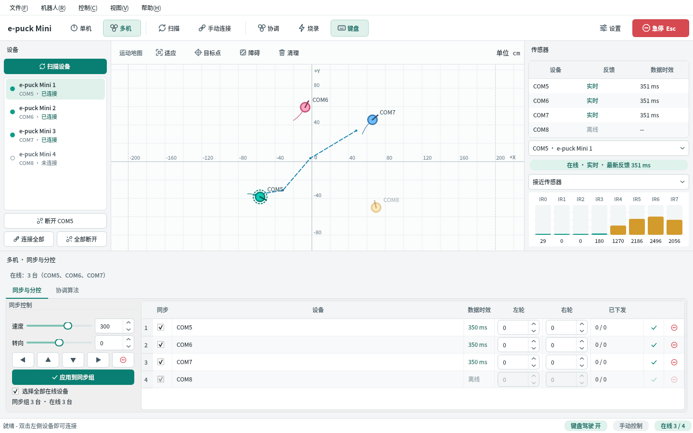
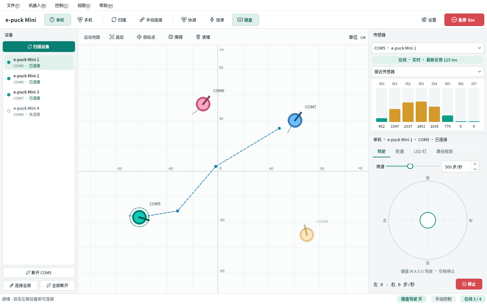

# 通信、流畅度与验收

适用 0.6.0。默认后端为经典蓝牙 SPP 虚拟 COM，不是已接通的 BLE GATT。

## 线程与时序

```text
后台线程池：端口枚举、2..4 个并发识别任务
主线程：状态、选中对象、可见 UI、20 Hz 轻量协调算法
每设备线程：QSerialPort、遥测/图像事务、命令定时器、看门狗
规划线程/进程：内置 A*，或异步 Python/MATLAB
```

选中对象只决定详细显示和单机手动控制，不决定哪些串口在线。同步勾选只决定群体命令成员，未勾选设备仍接收遥测。

轮速批次共享序号和 steady_clock 截止时间，默认提前 12 ms；端口线程使用精确定时器。更新待发命令时保留较早截止时间，避免持续输入导致不断推迟。零速立即排队并替换待发运动，旧序号不能覆盖新命令。

这是主机批量调度，不能保证电机同时执行。精确同步还需机器人时钟校准、固件执行时间戳、命令序号确认、实际轮速与丢包统计。

## 官方 BTcom 命令

二进制字节是对应字符的负值，各组以 0x00 结束。传感器回复没有 ASCII 行分隔，内部 0x0A/0x0D 是普通数据。

| 查询/命令 | 字符 | 字节 | 回复长度 |
| --- | --- | --- | --- |
| 接近 | N | B2 | 16 字节 |
| 加速度球坐标 | A | BF | 12 字节，三个 float |
| 原始加速度 | a | 9F | 6 字节 |
| 编码器 | Q | AF | 4 字节 |
| 麦克风 | u | 8B | 6 字节 |
| 图像 | I | B7 | 3 字节帧头 + 像素 |
| 电机设置 | D | BC | 无数据回复 |
| LED 设置 | L | B4 | 无数据回复 |

遥测发送 B2 BF 9F AF 8B 00，完整接收 44 字节按请求顺序解析。基础兼容发送 B2 BF 00，接收 28 字节。Selector 使用 C\r ASCII 握手并记录一次。

图像初始化 J,0,40,40,8\r，仅查看摄像头时请求，最多等 2 秒。该端口完成一帧前不发下一次遥测查询，电机仍可排队发送。未知帧头或超时进入迟到字节隔离及重新同步，不把半帧当有效数据。

## 链路监视与重连（0.6.0）

每个端口线程自己判断链路是否还活着，判定结果交给主线程的 SerialManager 决定是否重连。

| 事件 | 判定 | 结果 |
| --- | --- | --- |
| 遥测帧超时 | 发出轮询后 500 ms 未收齐 | 清空输入，隔离 180 ms 后重新轮询；一段连续超时只提示一次 |
| 基础固件 | 扩展轮询连续 2 次超时且恰好收到 28 字节 | 切换到 N + A 兼容轮询 |
| 链路假死 | 本次连接已收到过遥测帧，之后连续 8 次超时（约 5~6 s） | 尽力发送一次零速，关闭端口，报告断开 |
| 无遥测固件 | 本次连接从未收到遥测帧，连续 6 次超时 | 保持连接，轮询降为 1000 ms；之后一旦收到有效帧恢复设定间隔 |
| 串口错误 | ResourceError / DeviceNotFoundError / PermissionError | 关闭端口，报告断开 |

SerialManager 只对**曾经连接成功**且**不是用户主动断开**的链路重连：第 n 次等待 min(8 s, 2^(n-1) s)，默认最多 3 次。等待期间机器人状态为“连接中”，因此参与的协调算法会立即停止、记录的下发轮速清零；等待中的端口不参与后台扫描。用户点“断开”会取消等待中的重连。首次连接失败不重试。

关闭程序时先向每个端口线程排入 closePort（发送零速和退出二进制模式），所有线程共用 2 s 等待期限；超时的线程不再等待，由进程退出回收。

这些时序用模拟设备验证，真实蓝牙 SPP 端口在掉线后重新可打开所需的时间取决于系统蓝牙栈，可能长于默认的三次重试窗口（1 + 2 + 4 s 加每次握手约 1.5 s）。

## 信号真实性

- validFields 表示字段曾收到有效值，fieldTimestamps 为最后有效更新时间。
- 零值也是有效数据，部分更新不覆盖其他字段。
- 过期、离线和未接入须与最后数值一起解释，不能只看柱状图。
- 接近显示归零/平滑后的 ADC 响应，不是标定距离；原始加速度是 ADC。
- 标准电池百分比不能伪造电池电压。
- 编码器驱动相对里程计，初始位姿、轮径/轮距和轮滑决定精度。
- 看门狗在上位机端；PC 断电或蓝牙物理断开后无法保证停止送达，固件也应具备自己的超时停机。

## 自动化验证

测试覆盖构造协议帧、零值合并、截断通知、非方形图像旋转、编码器回绕、命令合并/停止优先、四设备同步与分控、移除设备、1024×720/1440×900 两种布局、异步规划、八设备遥测突发和日志滚动。

0.6.0 起，链路测试在 Linux / macOS 上通过伪终端连接一台模拟 e-puck（tests/FakeEpuck.h），真实的 SerialManager 和端口线程与它完成握手、44 字节遥测、电机指令、看门狗、掉线重连和关闭流程；键盘驾驶、急停、失焦停止、地图手势和设置持久化由界面测试覆盖。

模拟设备不是蓝牙链路，不能宣称实测蓝牙时延或硬件同步。八机突发检验 1200 次部分状态更新期间事件循环可处理事件，不代表实机持续采样率。

0.6.0 回归（Linux，GCC 11，Qt 6.10.3，Debug）：71/71 通过（glib 与非 glib 事件循环各一遍）；其中 15 项链路测试在 Windows 上不编译。0.6.0 尚未在 Windows 和真实机器人上运行。以下截图使用四台模拟设备的状态，不是实机在线证明。





## 实机验收

1. 正确端口握手成功，空端口超时不假在线；关闭和取消不闪退。
2. 接近/麦克风从非零归零后 UI 更新，字段时间持续更新。
3. 切换摄像头设备不残留上一台图；退出摄像头后遥测恢复，其他设备不受影响。
4. 两机以上连接全部，选择不同对象在线数不变，各数据独立更新。
5. 低速应用同步正负输入，未勾选设备不动；逐台停止只停止对应行。
6. 松开方向/摇杆/W A S D、切模式、失焦（Alt+Tab 到其他窗口）、空格、全局急停，检查实际停止而非仅看命令列。
7. 停止编码器输出，自动算法约 1 秒后暂停；参与设备断线则协调停止。
8. 运行中关闭机器人电源：约 6 秒内列表显示“重连中”，重新开机后在重试窗口内自动恢复遥测；记录真实蓝牙端口恢复所需时间，必要时调大重连次数。
9. 重启软件：上次的设备出现在列表中，开启“启动时自动连接”后无需操作即可连上。
10. 测量低速直行和旋转，标定轮径/轮距/步数，检查路径累计漂移。
11. 逐步增加设备数，至少运行 30 分钟，记录 UI 延迟、超时、实际轮速与日志增长。
12. 用固件回执或外部定位记录执行时差，不能用主机排队时间替代。

先抬起轮子或在隔离场地低速验证，再运行路径/编队。虚拟障碍不是实时物理障碍检测，目前没有已认证的统一碰撞安全层。
